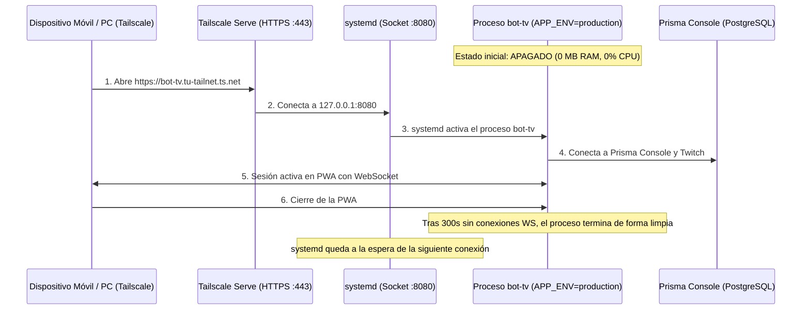

# Guía de Despliegue con Tailscale, Prisma Console y Encendido Bajo Demanda

Esta guía detalla cómo operar **bot-tv (`v1.0.0-beta.1`)** aprovechando la infraestructura configurada:

1. **Base de datos lista en la nube**: Utiliza **Prisma Console (Prisma Postgres)**, por lo que **no se requiere base de datos adicional**. Tanto en modo `development` (local) como en `production` (servidor), el bot lee tokens cifrados y datos directamente de Prisma Console.
2. **Acceso Privado con Tailscale (`tailscale serve`)**: Acceso restringido exclusivamente a tus dispositivos autorizados (PC y móvil), sin exponer puertos públicamente y con **certificado HTTPS válido automático (`https://<nodo>.<tailnet>.ts.net`)** para instalar la PWA en el móvil.
3. **Encendido bajo demanda (`APP_ENV=production`)**: Activación automática al acceder a la URL y apagado automático (`IDLE_SHUTDOWN_SECONDS=300`) tras 5 minutos de inactividad sin clientes WebSocket conectados.
4. **Compilación Frontend con Vite**: En despliegues de producción, los artefactos de la interfaz se generan mediante `pnpm run build` hacia `src/bot_tv/web/dist/`, sirviéndose con cabeceras de caché inmutable para activos versionados.

---

## 1. Perfiles de Ejecución: `development` vs `production`

El sistema define dos perfiles configurables mediante la variable `APP_ENV`:

| Característica        | `APP_ENV=development` (Local / LAN por defecto)                                                                      | `APP_ENV=production` (Servidor / Producción)                                          |
| --------------------- | -------------------------------------------------------------------------------------------------------------------- | ------------------------------------------------------------------------------------- |
| **Objetivo**          | Desarrollo y uso diario en PC o red local (LAN)                                                                      | Servidor remoto, VM privada con Tailscale o proxy inverso                             |
| **Frontend**          | Sirve `src/bot_tv/web/dist/` (o fallback a `static/` si no se compiló); soporta Vite HMR (`pnpm dev` en puerto 5173) | Sirve exclusivamente el bundle compilado en `src/bot_tv/web/dist/` (`pnpm run build`) |
| **Certificados TLS**  | Detecta automáticamente `certs/*-key.pem` y `certs/*.pem` si existen para HTTPS en LAN                               | Delega TLS al proxy inverso (Tailscale Serve, Caddy, Nginx) y añade cabecera `HSTS`   |
| **Caché Estática**    | `no-cache` / revalidación en assets dinámicos                                                                        | Caché inmutable (`immutable, max-age=31536000`) para bundles con hash de Vite         |
| **Límite WebSocket**  | `MAX_WS_CLIENTS = 20` (pruebas multidispositivo en LAN)                                                              | `MAX_WS_CLIENTS = 3` (optimizado para uso personal: PC + Móvil)                       |
| **Auto-Apagado Idle** | `IDLE_SHUTDOWN_SECONDS = 0` (desactivado, permanece encendido)                                                       | `IDLE_SHUTDOWN_SECONDS = 300` (se apaga automáticamente tras 5 min sin clientes WS)   |
| **Proxy Forwarding**  | Acepta `127.0.0.1,::1` por defecto                                                                                   | Configurable mediante `FORWARDED_ALLOW_IPS` para el proxy correspondiente             |

---

## 2. Preparación para Producción

Antes de ejecutar el servidor con `APP_ENV=production`, se debe compilar el frontend y asegurar las migraciones de base de datos:

```bash
# 1. Instalar dependencias
uv sync
pnpm install

# 2. Compilar el frontend optimizado con Vite
pnpm run build

# 3. Aplicar migraciones en PostgreSQL
pnpm run prisma:deploy
```

Si el servidor arranca sin haber ejecutado `pnpm run build`, la función `_ensure_frontend_dist()` en `src/bot_tv/web/server.py` emitirá una advertencia y servirá temporalmente `src/bot_tv/web/static/` para no bloquear el servicio ASGI.

---

## 3. Autenticación y Seguridad en Acceso Remoto

### Token de Acceso Web (`WEB_ACCESS_TOKEN`)

Para proteger el Dashboard Web frente a accesos no autorizados en entornos de red:

1. Configura una clave secreta en `.env`:
   ```bash
   WEB_ACCESS_TOKEN=tu_clave_secreta_aqui
   ```
2. Al ingresar por primera vez desde el navegador o PWA móvil, añade el parámetro:
   ```
   https://tu-host:8080/?token=tu_clave_secreta_aqui
   ```
3. El middleware ASGI valida el token, emite una cookie de sesión segura `HttpOnly; SameSite=Lax` (`bot_tv_token`) y redirige de inmediato a la ruta limpia (`/`) eliminando el token de la barra de direcciones y del historial.
4. Las rutas públicas requeridas para la instalación PWA (`/manifest.json`, `/sw.js`, `/favicon.ico`, `/icons/*`) y la sonda de salud (`/api/health`) permanecen accesibles sin token.

### Redes de Confianza y Proxies (`FORWARDED_ALLOW_IPS`)

Cuando el bot corre detrás de un terminador TLS o proxy inverso, se debe definir `FORWARDED_ALLOW_IPS` con la IP del proxy (por defecto `127.0.0.1,::1`) para que Uvicorn procese adecuadamente `X-Forwarded-For` y `X-Forwarded-Proto`.

---

## 4. Arquitectura de Despliegue con Tailscale y Encendido Bajo Demanda

### VM o Servidor Privado + `tailscale serve` + Activación por Socket (`systemd`)

Para mantener el consumo en cero mientras no se utiliza el dashboard, se puede combinar un socket de `systemd` con `tailscale serve`:



#### Pasos de Configuración:

1. **Habilitar HTTPS en Tailscale**:
   En el panel de control de Tailscale (_DNS_ -> _HTTPS Certificates_), activa la opción de certificados. Luego, en el servidor:

   ```bash
   sudo tailscale serve --bg --https=443 http://127.0.0.1:8080
   ```

   Esto provee una URL con certificado Let's Encrypt válido (`https://<nombre-host>.<tailnet>.ts.net`), permitiendo la instalación de la PWA sin excepciones de seguridad.

2. **Unidad de Servicio Systemd (`/etc/systemd/system/bot-tv.service`)**:

   ```ini
   [Unit]
   Description=bot-tv Web App y Twitch Bot (On-Demand)
   After=network.target tailscaled.service

   [Service]
   Type=simple
   User=ubuntu
   WorkingDirectory=/home/ubuntu/bot-tv
   Environment="APP_ENV=production"
   Environment="WEB_HOST=127.0.0.1"
   Environment="WEB_PORT=8080"
   Environment="IDLE_SHUTDOWN_SECONDS=300"
   Environment="MAX_WS_CLIENTS=3"
   ExecStart=/home/ubuntu/.local/bin/uv run --no-sync bot-tv
   Restart=no
   ```

3. **Activador de Socket (`/etc/systemd/system/bot-tv-proxy.socket`)**:
   Configurado con `systemd-socket-proxyd` para derivar el tráfico al servicio únicamente ante peticiones entrantes.
