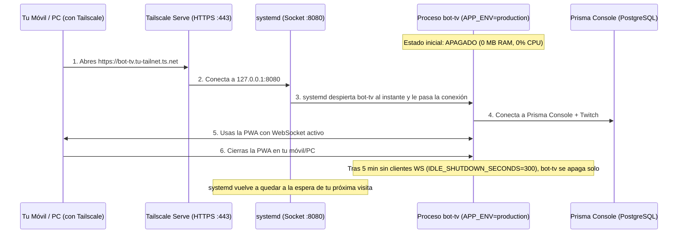

# Guía de Despliegue Gratis con Tailscale, Prisma Console y Encendido Bajo Demanda

Esta guía detalla cómo operar **bot-tv (`v1.0.0-beta.1`)** aprovechando tu infraestructura actual:
1. **Base de datos ya lista en la nube**: Usas **Prisma Console (Prisma Postgres)**, por lo que **no necesitas crear ni pagar ninguna base de datos adicional**. Tanto en modo `development` (local) como en `production` (nube), el bot lee tus tokens cifrados y datos directamente de Prisma Console.
2. **100% Gratis sin cobros sorpresa**: Alternativas reales a Cloud Run donde nunca te cobrarán por tiempo encendido.
3. **Integración nativa con Tailscale (`tailscale serve`)**: Acceso privado solo para tus dispositivos (PC y móvil), sin abrir puertos al público y con **certificado HTTPS válido automático (`https://<nodo>.<tailnet>.ts.net`)** para instalar la PWA en tu móvil.
4. **Encendido solo cuando lo usas (`APP_ENV=production`)**: Activación automática al entrar a la URL de Tailscale y apagado automático (`IDLE_SHUTDOWN_SECONDS=300`) cuando cierras la aplicación.

---

## 1. Perfiles de Ejecución: `development` vs `production`

El proyecto cuenta ahora con dos estados configurables mediante `APP_ENV` en [env.py](../src/bot_tv/utils/env.py):

| Característica | `APP_ENV=development` (Local por defecto) | `APP_ENV=production` (Nube / Servidor Tailscale) |
|---|---|---|
| **Objetivo** | Desarrollo y uso en tu PC / red LAN local | Servidor remoto privado con Tailscale o Contenedor |
| **Certificados TLS** | Usa `certs/*.pem` locales si existen (`https://192.168.x.x:8080`) | Delega HTTPS a **Tailscale Serve** o proxy cloud + activa `HSTS` |
| **Live Reload** | **Activo** (`watchfiles` recarga la web al editar CSS/JS) | **Desactivado** (0 consumo de CPU/inotify en vigilancia de archivos) |
| **Caché Estática** | `no-cache, no-store` (cambios inmediatos) | `max-age=3600, stale-while-revalidate=86400` (carga instantánea) |
| **Límite WebSocket** | `MAX_WS_CLIENTS = 20` | `MAX_WS_CLIENTS = 3` (pensado para ti como único usuario: PC + Móvil) |
| **Auto-Apagado Idle** | `IDLE_SHUTDOWN_SECONDS = 0` (siempre encendido) | `IDLE_SHUTDOWN_SECONDS = 300` (se apaga solo tras 5 min sin usar la web) |

---

## 2. Cómo lograr Costo $0 Real + Tailscale + Encendido Solo al Usarlo

Tienes razón respecto a **Google Cloud Run**: aunque tiene una capa gratuita mensual, exige tarjeta y si una conexión WebSocket mantiene la instancia encendida con CPU asignada durante muchas horas al mes, al superar las ~50 horas mensuales comenzaría a facturar centavos/dólares.

Si ya usas **Tailscale** y buscas **costo \$0 garantizado** + **que el bot solo corra cuando abres la PWA**, estas son las **2 mejores arquitecturas gratuitas**:

### Opción A (La Mejor con Tailscale): VM Gratuita Permanente + `tailscale serve` + Activación por Socket (`systemd`)

Proveedores con instancia **100% gratuita de por vida ($0 siempre)**:
- **Oracle Cloud Always Free**: Te da gratis para siempre hasta **2 VMs AMD Micro** o **1 VM ARM Ampere A1 (hasta 4 CPUs y 24 GB RAM)**.
- *(Alternativa sin tarjeta)*: Si tienes un mini-PC / Raspberry Pi / servidor casero o un contenedor LXC con Tailscale.

#### ¿Cómo funciona el encendido bajo demanda con `systemd` + Tailscale?
En lugar de dejar `bot-tv` corriendo 24/7 consumiendo RAM, configuras un **Socket de Systemd (`bot-tv.socket`)** escuchando en `127.0.0.1:8080` y expones ese puerto en tu Tailnet con `tailscale serve`:



#### Pasos de configuración (una sola vez):

1. **Habilitar HTTPS en Tailscale**:
   En el panel web de Tailscale (*DNS* -> *HTTPS Certificates*), activa **Enable HTTPS**. Luego, en el servidor ejecuta:
   ```bash
   sudo tailscale serve --bg --https=443 http://127.0.0.1:8080
   ```
   Esto te dará una URL privada **`https://<nombre-maquina>.<tu-tailnet>.ts.net`** con certificado Let's Encrypt real (la PWA se instalará en tu móvil sin ninguna advertencia de certificado).

2. **Crear el servicio con apagado automático (`/etc/systemd/system/bot-tv.service`)**:
   ```ini
   [Unit]
   Description=bot-tv Web App & Twitch Bot (On-Demand)
   After=network.target tailscaled.service

   [Service]
   Type=simple
   User=ubuntu
   WorkingDirectory=/home/ubuntu/bot-tv
   Environment="APP_ENV=production"
   Environment="WEB_HOST=127.0.0.1"
   Environment="WEB_PORT=8080"
   Environment="IDLE_SHUTDOWN_SECONDS=300"
   ExecStart=/home/ubuntu/.local/bin/uv run --no-sync bot-tv
   Restart=no
   ```
   - Cuando se cumplan los 300 segundos (5 minutos) después de que cierres la pestaña de la PWA, `bot-tv` terminará limpiamente con código `0` y **quedará completamente apagado**.

3. **Crear el activador bajo demanda (`/etc/systemd/system/bot-tv-proxy.socket` y `.service`)**:
   Usando `systemd-socket-proxyd` en el puerto `8080` hacia el puerto interno `8081` de `bot-tv`, cada vez que abras `https://<nombre-maquina>.<tu-tailnet>.ts.net`, Linux levantará `bot-tv.service` automáticamente en el acto.

---

### Opción B (Sin administrar servidor Linux): GitHub Codespaces + Tailscale (Gratis con tu cuenta de GitHub)

Si no quieres crear una cuenta en ningún proveedor cloud y quieres algo **100% gratis usando solo tu cuenta de GitHub**:
- **GitHub Codespaces** incluye **120 horas de núcleo (60 horas de máquina de 2 núcleos) y 15 GB de almacenamiento gratis cada mes** (y si eres estudiante con GitHub Student Developer Pack, aún más), con **tope de gasto en \$0.00 por defecto** (jamás te cobra si no activas presupuesto extra).
- Se enciende **únicamente cuando lo abres**, se apaga solo tras unos minutos de inactividad, permite instalar la extensión oficial de **Tailscale** o usar el túnel privado HTTPS de GitHub (`https://...-8080.app.github.dev`) donde **solo tu cuenta de GitHub tiene permiso de entrar**.
- Como tu base de datos ya está en **Prisma Console**, el Codespace no pierde ningún dato al apagarse.
